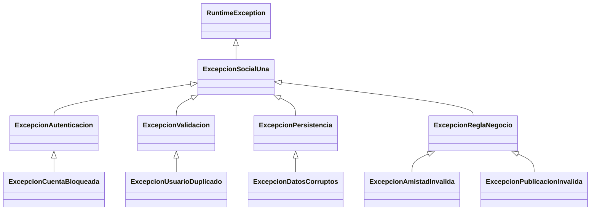
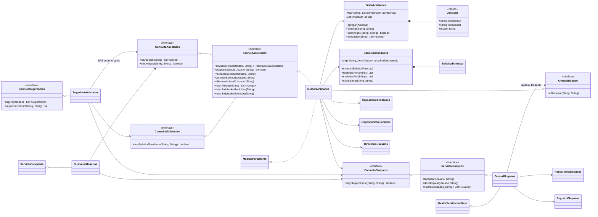
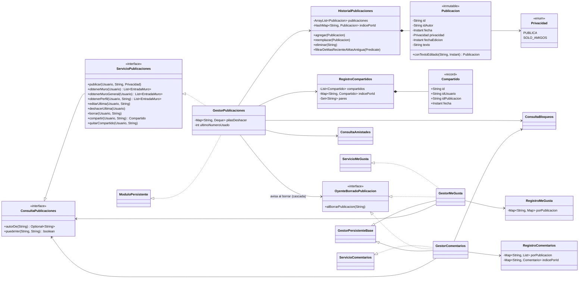
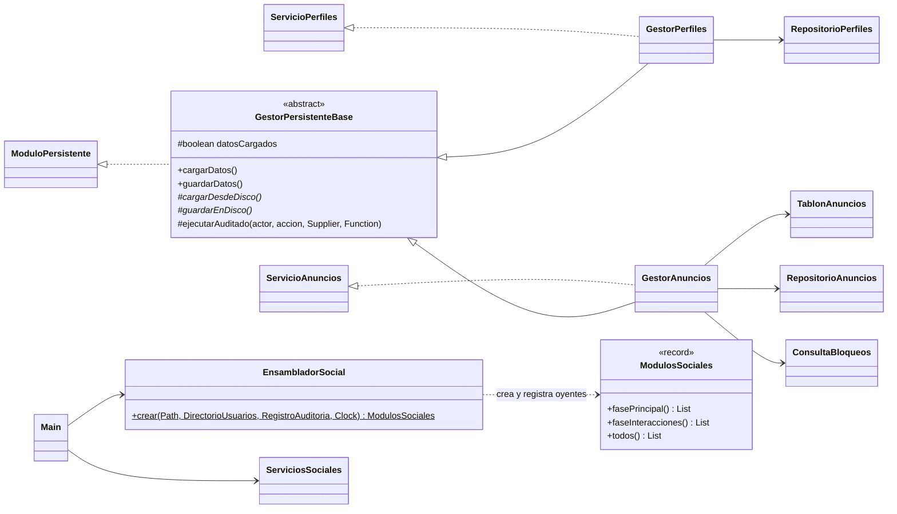
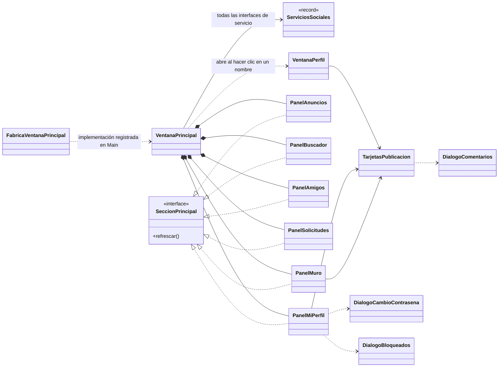

# Diagramas de clases de Social UNA

Diagramas UML básicos en Mermaid (se ven como dibujo en GitHub y en VS Code con una extensión de
Mermaid). Muestran cómo se organiza la memoria (catálogo, grafo de amistades, historial de
publicaciones) y la lógica. Primero la parte de Andrey (usuarios, seguridad, auditoría) y al final
la de Sebastián (módulo social).

## Parte de Andrey: usuarios, seguridad, auditoría y navegación

Leyenda: `<|..` implementa una interfaz · `<|--` hereda · `-->` usa / depende de · `*--` contiene.

```mermaid
classDiagram
    direction LR

    %% ---------------- Modelo y estructura de datos en memoria
    class Usuario {
        <<inmutable>>
        -String id
        -String nombre
        -String nombreUsuario
        -String hashContrasena
        -String sal
        -Instant fechaRegistro
    }
    class CatalogoUsuarios {
        -ArrayList~Usuario~ usuarios
        -HashMap~String,Usuario~ indicePorNombreUsuario
        -HashMap~String,Usuario~ indicePorId
        +agregar(Usuario)
        +buscarPorNombreUsuario(String) Optional~Usuario~
        +buscarPorId(String) Optional~Usuario~
        +listarTodos() List~Usuario~
    }
    CatalogoUsuarios *-- Usuario

    %% ---------------- Servicio (interfaces pequeñas, ISP)
    class DirectorioUsuarios {
        <<interface>>
        +buscarPorId(String)
        +buscarPorNombreUsuario(String)
        +listarTodos()
    }
    class ServicioAutenticacion {
        <<interface>>
        +autenticar(String, char[]) Usuario
    }
    class ServicioRegistro {
        <<interface>>
        +registrar(String, String, char[], char[]) Usuario
    }
    class ServicioCuenta {
        <<interface>>
        +cambiarNombre(Usuario, String) Usuario
        +cambiarContrasena(Usuario, char[], char[], char[])
    }
    class ModuloPersistente {
        <<interface>>
        +cargarDatos()
        +guardarDatos()
    }
    class GestorUsuarios
    DirectorioUsuarios <|.. GestorUsuarios
    ServicioAutenticacion <|.. GestorUsuarios
    ServicioRegistro <|.. GestorUsuarios
    ServicioCuenta <|.. GestorUsuarios
    ModuloPersistente <|.. GestorUsuarios
    GestorUsuarios --> CatalogoUsuarios
    GestorUsuarios --> RepositorioUsuarios
    GestorUsuarios --> HasheadorContrasenas
    GestorUsuarios --> ControlIntentosLogin
    GestorUsuarios --> RegistroAuditoria
    GestorUsuarios ..> ValidadorDatosUsuario

    %% ---------------- Persistencia
    class RepositorioUsuarios {
        <<interface>>
        +cargarTodos() List~Usuario~
        +guardarTodos(List~Usuario~)
    }
    class RepositorioUsuariosArchivoTexto
    class AlmacenArchivoTexto {
        <<utilidad compartida>>
        +leerLineasDeDatos(Path)
        +escribirLineasAtomicamente(Path, List)
        +escaparCampo(String)
        +desescaparCampo(String)
        +dividirCampos(String)
        +leerRegistro(String, int)
    }
    class CoordinadorPersistencia
    RepositorioUsuarios <|.. RepositorioUsuariosArchivoTexto
    RepositorioUsuariosArchivoTexto --> AlmacenArchivoTexto
    RepositorioUsuariosArchivoTexto --> RegistroAuditoria
    CoordinadorPersistencia --> ModuloPersistente

    %% ---------------- Seguridad
    class HasheadorContrasenas {
        <<interface>>
        +proteger(char[]) CredencialProtegida
        +verificar(char[], CredencialProtegida) boolean
    }
    class HasheadorPbkdf2
    class HasheadorTextoPlano
    class ControlIntentosLogin
    HasheadorContrasenas <|.. HasheadorPbkdf2
    HasheadorContrasenas <|.. HasheadorTextoPlano : el que usa la app (decisión de Andrey)

    %% ---------------- Auditoría
    class RegistroAuditoria {
        <<interface>>
        +registrar(NivelAuditoria, String, String, String)
    }
    class RegistroAuditoriaArchivo
    class VerificadorIntegridadAuditoria {
        +verificar() ResultadoVerificacion
    }
    RegistroAuditoria <|.. RegistroAuditoriaArchivo
    RegistroAuditoriaArchivo ..> FormatoLineaAuditoria
    VerificadorIntegridadAuditoria ..> FormatoLineaAuditoria

    %% ---------------- UI
    class FabricaVentanaPrincipal {
        <<interface>>
        +crear(Usuario, Runnable) JFrame
    }
    class ControladorNavegacion
    class VentanaLogin
    class VentanaRegistro
    class VentanaPrincipalTemporal
    class ContextoSesion
    class TemaUi {
        <<utilidad compartida>>
    }
    ControladorNavegacion --> VentanaLogin
    ControladorNavegacion --> VentanaRegistro
    ControladorNavegacion --> FabricaVentanaPrincipal
    ControladorNavegacion --> ContextoSesion
    ControladorNavegacion --> CoordinadorPersistencia
    FabricaVentanaPrincipal ..> VentanaPrincipalTemporal : implementación por defecto
    VentanaLogin --> ServicioAutenticacion
    VentanaRegistro --> ServicioRegistro
    VentanaLogin ..> TemaUi
    VentanaRegistro ..> TemaUi

    %% ---------------- Arranque
    class Main
    class EnsambladorServicios
    Main --> EnsambladorServicios
    Main --> ControladorNavegacion
    Main --> VerificadorIntegridadAuditoria
    Main --> ManejadorErroresGlobal
```

## Jerarquía de excepciones

`ExcepcionReglaNegocio` = una regla del negocio no se cumplió ("ya son amigos", "comentario de más
de 300 caracteres"...). La interfaz la muestra como **advertencia** con el mensaje amigable; los
demás errores se muestran como error y su detalle técnico va a la auditoría.

## Cómo viaja un registro (resumen)

1. `VentanaRegistro` lee los campos (contraseñas como `char[]`) y llama a `ServicioRegistro.registrar`
   dentro de un `SwingWorker` (la ventana no se congela).
2. `GestorUsuarios` valida (`ValidadorDatosUsuario`), revisa duplicados en el `HashMap` del catálogo,
   protege la contraseña con PBKDF2 + sal y calcula el siguiente ID (`U` + máximo + 1).
3. Guarda **primero en disco** (`RepositorioUsuariosArchivoTexto` → escritura atómica) y **después en
   memoria** (`CatalogoUsuarios.agregar`), así la memoria nunca queda distinta del archivo.
4. Audita `REGISTRO_EXITOSO` (sin datos sensibles); la ventana muestra el ID asignado.

## Parte de Sebastián (1): amistades, solicitudes, bloqueos y sugerencias

## Parte de Sebastián (2): publicaciones, compartidos, me gusta y comentarios

## Parte de Sebastián (3): perfiles, anuncios, persistencia común y ensamblado

## Parte de Sebastián (4): interfaz gráfica

## Algoritmos explicados (para la defensa)

### Muro "Mis amigos" y "Muro general"

1. El gestor filtra el `ArrayList` cronológico de publicaciones **de atrás hacia adelante** (más
   reciente primero), sin ordenar: en "Mis amigos" se queda con las mías y las de mis amigos (las
   "Solo amigos" incluidas); en "Muro general", solo con las `PUBLICA`. En ambas se descarta todo
   autor con bloqueo.
2. Hace lo mismo con los compartidos (en "Mis amigos": los que compartimos yo y mis amigos; en el
   general: todos los que se pueden ver).
3. **Mezcla** las dos listas ya ordenadas como en *merge sort*: compara la cabeza de cada una y
   toma la más reciente. O(n + m), sin volver a ordenar.

### Personas que quizás conozcas (BFS a 2 niveles)

1. Cola (`ArrayDeque`) que empieza con "yo" a distancia 0 y un `HashMap` de distancias.
2. Se saca un usuario de la cola; cada vecino no visitado se anota con distancia + 1 y se encola.
   Los de nivel 2 ya no se exploran (sus amigos serían nivel 3 y no se sugieren).
3. Cada vez que un amigo mío (nivel 1) lleva a alguien de nivel 2, se suma 1 a su contador de
   **amigos en común** en un `HashMap<id, cantidad>`.
4. Se quitan: yo, mis amigos, bloqueados (en cualquier sentido) y quien tenga una solicitud
   pendiente conmigo. Se ordena por amigos en común (mayor primero) y, si empatan, por nombre. Se
   devuelven como máximo 10.

### Cola de solicitudes (FIFO)

Cada destinatario tiene un `ArrayDeque`: las solicitudes nuevas entran al final y se muestran
desde el frente, en el orden en que llegaron. Al cargar el archivo se ordenan por fecha antes de
encolar. Si A le envía a B y B ya le había enviado a A, no se encola: se acepta la de B
automáticamente.

### Pila de deshacer (LIFO)

Cada usuario tiene un `ArrayDeque` usado como pila: al publicar se hace `push` del ID; "Deshacer"
hace `pop` y borra esa publicación (con su cascada). Solo guarda lo publicado en **esta sesión de la
aplicación** (vive en memoria): no se puede deshacer algo publicado ayer; para eso está "Borrar".

### Borrado en cascada y bloqueo (patrón Observador)

`GestorPublicaciones` borra la publicación y avisa a sus oyentes (`OyenteBorradoPublicacion`):
`GestorMeGusta` y `GestorComentarios` borran los suyos y lo guardan. Los compartidos **no** se
borran: quedan como "La publicación original ya no está disponible". Igual con el bloqueo:
`GestorBloqueos` guarda el bloqueo y avisa a `GestorAmistades` (`OyenteBloqueo`), que elimina la
amistad y las solicitudes entre ambos.
