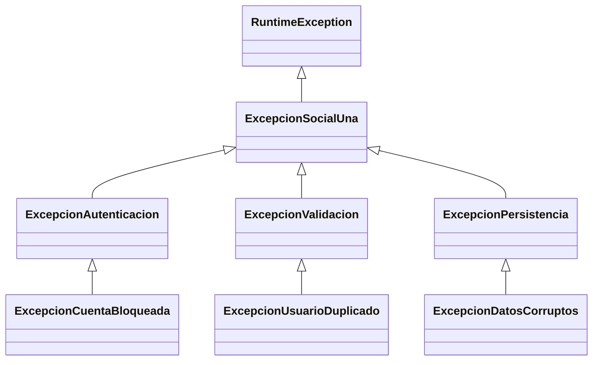

# Diagrama de clases (parte de Andrey)

Diagrama UML básico en Mermaid (se ve como dibujo en GitHub y en VS Code con una extensión de
Mermaid). Muestra cómo se organiza la memoria (catálogo con lista + índices) y la lógica.

Leyenda: `<|..` implementa una interfaz · `<|--` hereda · `-->` usa / depende de · `*--` contiene.

```mermaid
classDiagram
    direction LR

    %% ---------------- Modelo y estructura de datos en memoria
    class Usuario {
        <<inmutable>>
        -String id
        -String nombre
        -String nombreUsuario
        -String hashContrasena
        -String sal
        -Instant fechaRegistro
    }
    class CatalogoUsuarios {
        -ArrayList~Usuario~ usuarios
        -HashMap~String,Usuario~ indicePorNombreUsuario
        -HashMap~String,Usuario~ indicePorId
        +agregar(Usuario)
        +buscarPorNombreUsuario(String) Optional~Usuario~
        +buscarPorId(String) Optional~Usuario~
        +listarTodos() List~Usuario~
    }
    CatalogoUsuarios *-- Usuario

    %% ---------------- Servicio (interfaces pequeñas, ISP)
    class DirectorioUsuarios {
        <<interface>>
        +buscarPorId(String)
        +buscarPorNombreUsuario(String)
        +listarTodos()
    }
    class ServicioAutenticacion {
        <<interface>>
        +autenticar(String, char[]) Usuario
    }
    class ServicioRegistro {
        <<interface>>
        +registrar(String, String, char[], char[]) Usuario
    }
    class ModuloPersistente {
        <<interface>>
        +cargarDatos()
        +guardarDatos()
    }
    class GestorUsuarios
    DirectorioUsuarios <|.. GestorUsuarios
    ServicioAutenticacion <|.. GestorUsuarios
    ServicioRegistro <|.. GestorUsuarios
    ModuloPersistente <|.. GestorUsuarios
    GestorUsuarios --> CatalogoUsuarios
    GestorUsuarios --> RepositorioUsuarios
    GestorUsuarios --> HasheadorContrasenas
    GestorUsuarios --> ControlIntentosLogin
    GestorUsuarios --> RegistroAuditoria
    GestorUsuarios ..> ValidadorDatosUsuario

    %% ---------------- Persistencia
    class RepositorioUsuarios {
        <<interface>>
        +cargarTodos() List~Usuario~
        +guardarTodos(List~Usuario~)
    }
    class RepositorioUsuariosArchivoTexto
    class AlmacenArchivoTexto {
        <<utilidad compartida>>
        +leerLineasDeDatos(Path)
        +escribirLineasAtomicamente(Path, List)
        +escaparCampo(String)
        +desescaparCampo(String)
        +dividirCampos(String)
        +leerRegistro(String, int)
    }
    class CoordinadorPersistencia
    RepositorioUsuarios <|.. RepositorioUsuariosArchivoTexto
    RepositorioUsuariosArchivoTexto --> AlmacenArchivoTexto
    RepositorioUsuariosArchivoTexto --> RegistroAuditoria
    CoordinadorPersistencia --> ModuloPersistente

    %% ---------------- Seguridad
    class HasheadorContrasenas {
        <<interface>>
        +proteger(char[]) CredencialProtegida
        +verificar(char[], CredencialProtegida) boolean
    }
    class HasheadorPbkdf2
    class ControlIntentosLogin
    HasheadorContrasenas <|.. HasheadorPbkdf2

    %% ---------------- Auditoría
    class RegistroAuditoria {
        <<interface>>
        +registrar(NivelAuditoria, String, String, String)
    }
    class RegistroAuditoriaArchivo
    class VerificadorIntegridadAuditoria {
        +verificar() ResultadoVerificacion
    }
    RegistroAuditoria <|.. RegistroAuditoriaArchivo
    RegistroAuditoriaArchivo ..> FormatoLineaAuditoria
    VerificadorIntegridadAuditoria ..> FormatoLineaAuditoria

    %% ---------------- UI
    class FabricaVentanaPrincipal {
        <<interface>>
        +crear(Usuario, Runnable) JFrame
    }
    class ControladorNavegacion
    class VentanaLogin
    class VentanaRegistro
    class VentanaPrincipalTemporal
    class ContextoSesion
    class TemaUi {
        <<utilidad compartida>>
    }
    ControladorNavegacion --> VentanaLogin
    ControladorNavegacion --> VentanaRegistro
    ControladorNavegacion --> FabricaVentanaPrincipal
    ControladorNavegacion --> ContextoSesion
    ControladorNavegacion --> CoordinadorPersistencia
    FabricaVentanaPrincipal ..> VentanaPrincipalTemporal : implementación por defecto
    VentanaLogin --> ServicioAutenticacion
    VentanaRegistro --> ServicioRegistro
    VentanaLogin ..> TemaUi
    VentanaRegistro ..> TemaUi

    %% ---------------- Arranque
    class Main
    class EnsambladorServicios
    Main --> EnsambladorServicios
    Main --> ControladorNavegacion
    Main --> VerificadorIntegridadAuditoria
    Main --> ManejadorErroresGlobal
```

## Jerarquía de excepciones

## Cómo viaja un registro (resumen)

1. `VentanaRegistro` lee los campos (contraseñas como `char[]`) y llama a `ServicioRegistro.registrar`
   dentro de un `SwingWorker` (la ventana no se congela).
2. `GestorUsuarios` valida (`ValidadorDatosUsuario`), revisa duplicados en el `HashMap` del catálogo,
   protege la contraseña con PBKDF2 + sal y calcula el siguiente ID (`U` + máximo + 1).
3. Guarda **primero en disco** (`RepositorioUsuariosArchivoTexto` → escritura atómica) y **después en
   memoria** (`CatalogoUsuarios.agregar`), así la memoria nunca queda distinta del archivo.
4. Audita `REGISTRO_EXITOSO` (sin datos sensibles); la ventana muestra el ID asignado.
