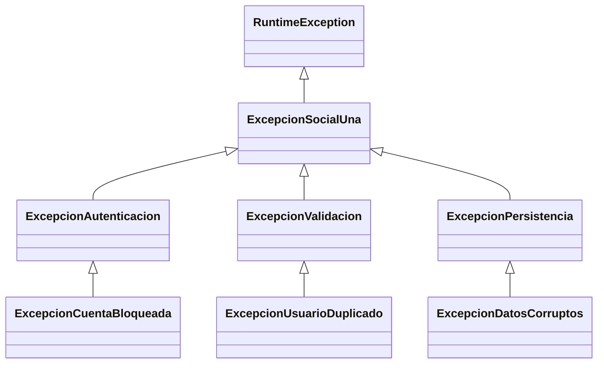

# Diagramas de clases de Social UNA

Diagramas UML básicos en Mermaid (se ven como dibujo en GitHub y en VS Code con una extensión de
Mermaid). Muestran cómo se organiza la memoria (catálogo, grafo de amistades, historial de
publicaciones) y la lógica. Primero la parte de Andrey (usuarios, seguridad, auditoría) y al final
la de Sebastián (módulo social).

## Parte de Andrey: usuarios, seguridad, auditoría y navegación

Leyenda: `<|..` implementa una interfaz · `<|--` hereda · `-->` usa / depende de · `*--` contiene.

## Jerarquía de excepciones

## Cómo viaja un registro (resumen)

1. `VentanaRegistro` lee los campos (contraseñas como `char[]`) y llama a `ServicioRegistro.registrar`
   dentro de un `SwingWorker` (la ventana no se congela).
2. `GestorUsuarios` valida (`ValidadorDatosUsuario`), revisa duplicados en el `HashMap` del catálogo,
   protege la contraseña con PBKDF2 + sal y calcula el siguiente ID (`U` + máximo + 1).
3. Guarda **primero en disco** (`RepositorioUsuariosArchivoTexto` → escritura atómica) y **después en
   memoria** (`CatalogoUsuarios.agregar`), así la memoria nunca queda distinta del archivo.
4. Audita `REGISTRO_EXITOSO` (sin datos sensibles); la ventana muestra el ID asignado.

## Parte de Sebastián: amistades, publicaciones y ventana principal

```mermaid
classDiagram
    direction LR

    %% ---------------- Amistades: grafo con listas de adyacencia
    class Amistad {
        <<record>>
        +String idUsuarioA
        +String idUsuarioB
        +Instant fecha
    }
    class GrafoAmistades {
        -Map~String, LinkedHashSet~ adyacencia
        -List~Amistad~ aristas
        +agregar(Amistad)
        +sonAmigos(String, String) boolean
        +amigosDe(String) Set~String~
    }
    GrafoAmistades *-- Amistad

    class ConsultaAmistades {
        <<interface>>
        +idsAmigos(String) Set~String~
        +sonAmigos(String, String) boolean
    }
    class ServicioAmistades {
        <<interface>>
        +agregarAmistad(Usuario, String) Amistad
        +listarAmigos(String) List~Amigo~
    }
    class ServicioBusqueda {
        <<interface>>
        +buscar(String, Usuario) List~ResultadoBusqueda~
    }
    ConsultaAmistades <|-- ServicioAmistades
    ServicioAmistades <|.. GestorAmistades
    ModuloPersistente <|.. GestorAmistades
    ServicioBusqueda <|.. BuscadorUsuarios
    GestorAmistades --> GrafoAmistades
    GestorAmistades --> RepositorioAmistades
    GestorAmistades --> DirectorioUsuarios
    BuscadorUsuarios --> DirectorioUsuarios
    BuscadorUsuarios --> ConsultaAmistades
    RepositorioAmistades <|.. RepositorioAmistadesArchivoTexto

    %% ---------------- Publicaciones: lista dinámica cronológica
    class Publicacion {
        <<inmutable>>
        -String id
        -String idAutor
        -Instant fecha
        -String texto
    }
    class HistorialPublicaciones {
        -ArrayList~Publicacion~ publicaciones
        -HashMap~String, Publicacion~ indicePorId
        +agregar(Publicacion)
        +muro(Set~String~) List~Publicacion~
    }
    HistorialPublicaciones *-- Publicacion
    class ServicioPublicaciones {
        <<interface>>
        +publicar(Usuario, String) Publicacion
        +obtenerMuro(Usuario) List~EntradaMuro~
    }
    ServicioPublicaciones <|.. GestorPublicaciones
    ModuloPersistente <|.. GestorPublicaciones
    GestorPublicaciones --> HistorialPublicaciones
    GestorPublicaciones --> RepositorioPublicaciones
    GestorPublicaciones --> ConsultaAmistades : autores visibles
    GestorPublicaciones --> DirectorioUsuarios
    RepositorioPublicaciones <|.. RepositorioPublicacionesArchivoTexto
    RepositorioAmistadesArchivoTexto ..> ArchivoRegistros
    RepositorioPublicacionesArchivoTexto ..> ArchivoRegistros

    %% ---------------- Interfaz gráfica
    class VentanaPrincipal
    class SeccionPrincipal {
        <<interface>>
        +refrescar()
    }
    SeccionPrincipal <|.. PanelMuro
    SeccionPrincipal <|.. PanelBuscador
    SeccionPrincipal <|.. PanelAmigos
    VentanaPrincipal *-- PanelMuro
    VentanaPrincipal *-- PanelBuscador
    VentanaPrincipal *-- PanelAmigos
    PanelMuro --> ServicioPublicaciones
    PanelBuscador --> ServicioBusqueda
    PanelBuscador --> ServicioAmistades
    PanelAmigos --> ServicioAmistades
    FabricaVentanaPrincipal ..> VentanaPrincipal : implementación registrada en Main
```

## Cómo se arma el muro (resumen)

1. `PanelMuro` pide `obtenerMuro(usuario)` en un `SwingWorker`.
2. `GestorPublicaciones` arma el conjunto de autores visibles: el usuario + `idsAmigos(usuario)`
   (sus vecinos en el grafo, O(1)).
3. `HistorialPublicaciones` recorre su `ArrayList` (ya en orden cronológico) **de atrás hacia
   adelante** y se queda con las publicaciones cuyo autor está en ese conjunto: salen de la más
   reciente a la más antigua sin ordenar nada (O(n)).
4. Cada publicación se une a su autor (`EntradaMuro`) y el panel dibuja una tarjeta por cada una.
